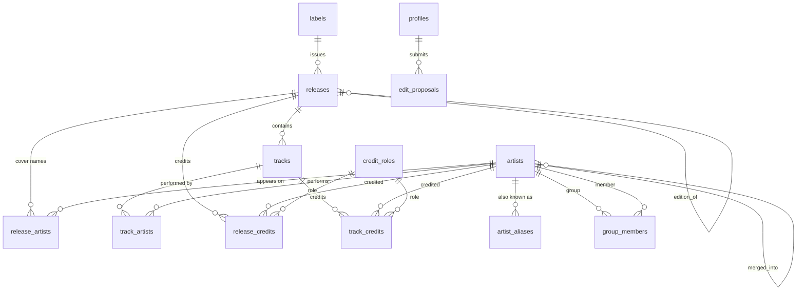

# Database design

This document describes the PostgreSQL database behind Ethiopian Music DB as of launch. The runnable
definition is [schema.sql](schema.sql), consolidated from initial design. Where this document
and the live database disagree, the live database is correct.

## Overview

The database stores a catalogue of Ethiopian music:

- **Artists**: people, groups and organizations (for example recording studios), with aliases, group membership
  and a way to merge duplicates.
- **Releases**: albums, singles, EPs and compilations. Each row is one specific edition or format; editions of the
  same work point to a main release.
- **Tracks** of a release, with optional per-track performers and featured artists.
- **Credits**: who did what (lyrics, melody, arrangement, instruments, studios, engineers) on a release or a track,
  using a shared list of **credit roles**.
- **Labels** that issued releases.
- **Streaming links** stored on each release.
- **Edit proposals**: suggested changes waiting for a moderator.
- **Profiles**: one row per account, holding the username and the role (user, moderator or admin).

Names and titles are stored in English and, where known, in Amharic (Ge'ez script).

The data comes from two sources:

- **Contributors** add and edit records through the website. Their records carry `created_by`.
- **Discogs**: part of the catalogue was imported from the Discogs monthly data dumps, which are CC0. Imported
  releases, artists and labels carry `source = 'discogs'` and the Discogs id in `source_id`; imported releases
  also record Discogs' data-quality grade in `source_quality`. Imported records have no owner (`created_by` is
  NULL).

## Relationships

Main tables only. `profiles` (referenced by every `created_by` column), `release_images` and `import_calls` are
left out for readability.

`edit_proposals.target_id` refers to a release, artist, label or track depending on `target_table`; it is not a
foreign key.

## Tables

### Artists, aliases and groups

`artists` holds people, groups and organizations; `entity_type` says which. Organizations exist so that studios can
be credited like people (a credit whose role contains "studio" creates an Organization).

- `name_en` (required) and `name_am` hold the two names. `sort_name` (surname first) is optional.
- `begin_year` / `end_year` are birth and death for people, formation and dissolution for groups (1800 to 2100).
- `bio_en` / `bio_am` are free text.
- `merged_into` handles duplicates. When two rows describe the same artist, `merge_artists` moves every credit,
  appearance, alias and membership to the artist being kept and leaves the duplicate as a stub pointing at it.
  Old links keep working, and the duplicate's names become aliases of the kept artist.
- `profile_image_key` is reserved for uploaded photos and is not used.

`artist_aliases` stores other spellings and names. An alias is unique per artist regardless of case. Search and
name matching look at aliases as well as names, so different spellings of a name resolve to one artist.

`group_members` links a group (`group_id`) to a member (`member_id`), both rows in `artists`, with optional years.
A group cannot be its own member. Adding a member requires edit rights on both artists, so nobody can attach a
well-known artist to their own group.

### Releases and editions

Each row in `releases` is one concrete edition: a cassette, an LP, a CD or a digital release, with its own label,
catalogue number, year and tracklist.

- `type` is Album, Single, EP or Compilation; `format` is Cassette, Vinyl, CD, Digital or Other.
- `release_year` uses the Gregorian calendar (1900 to 2100); `release_year_ec` holds the Ethiopian-calendar year
  when the release prints it that way (1890 to 2100).
- `youtube_video_id` (an 11-character video id) supplies the cover image through YouTube's thumbnail service.
  `cover_key` is reserved for uploaded covers and is not used.
- `streaming_links` is a JSON object of service name to https URL (for example `youtube`, `spotify`,
  `youtube-2`). The database checks that it is an object and at most 8 KB; the application checks hosts and URLs.
- `notes` is free text for anything that has no column.
- `edition_of` points an edition at its main release. Lists, counts and search show main releases only; the main
  release's page lists its editions. Only one level is allowed: a main release cannot itself be an edition, and a
  release that has editions cannot become one. Only staff can set or change `edition_of`.

Editions are rows in the same table, with a pointer to the main release. A separate "work" table would require
every release to have a parent, and most releases have only one edition.

`release_artists` lists the names printed on the cover, in order (`position`). It is separate from credits: a
compilation's cover says "Various Artists" while each track has its own performers.

### Tracks and performers

`tracks` belong to one release. A track is placed by `disc_number`, `side` (empty, or a single capital letter such
as A or B for cassettes and records) and `position`. These are unique per release; the check is deferred to the end
of the transaction so a tracklist can be reordered in one step. `duration_seconds` is optional.

`track_artists` lists a track's performers, with `is_featured` for featured artists. When a track has no rows here,
the release artists are taken to be the performers.

### Credits and roles

`credit_roles` is the shared list of roles (Lyrics, Melody, Arrangement, Krar, Recording Studio and so on), each
with an English and optional Amharic name. `scope` says whether a role is normally used on releases, tracks or both.
Role names are unique regardless of case.

When a contributor types a role that does not exist, it is created as a custom role (`is_custom = true`).
Moderators either make it official or merge it into an existing role (`merge_credit_role`).

`release_credits` and `track_credits` connect an artist and a role to a release or a track. `credited_as` keeps the
name exactly as printed when it differs from the artist's name; `notes` holds details such as a studio's city. A
role that is still in use cannot be deleted.

A new database starts with an empty role list. The live database was seeded with 47 official roles (29 in
migration 001, 18 more used by the Discogs import in migration 009); this seed data is not part of schema.sql.

### Labels

`labels` holds record labels with English and Amharic names. A release has at most one label. Deleting a label keeps
its releases and clears their `label_id`.

### Edit proposals

`edit_proposals` holds changes that a contributor may not apply directly.

- `target_table` says what is being changed: `releases`, `artists`, `labels` or `tracks` (field changes, stored as a
  JSON object of column to new value), `release_content` (a full replacement of a release's artists, credits and
  tracklist) or `artist_content` (an artist's aliases and group members).
- `status` is pending, approved or rejected. When a proposal is resolved, a trigger clears the payload and records
  the reviewer and time; the submitter's and moderator's notes remain.
- A contributor can see only their own proposals; staff can see all of them.

### Profiles

`profiles` has one row per account, created automatically when someone signs up. `username` is optional, 3 to 30
characters (letters, digits, dot, dash, underscore) and unique regardless of case. `role` is user, moderator or
admin; only an admin can change it.

### Provenance and ownership

Releases, artists, labels, tracks, credits, aliases, memberships and roles record `created_by` (the account that
added the row) and `created_at`. Releases, artists, labels and tracks also keep `updated_at`, and any change to a
release's tracks, credits, artists or images bumps the release's `updated_at`.

`source`, `source_id` and `source_quality` record where imported data came from. A Discogs id can appear at most
once per table, which makes the import safe to run again.

### Locking

`is_locked` on releases, artists and labels marks a record that moderators have checked ("canonical"). A locked
record can only be changed by staff; everyone else, including its creator, has to submit a proposal.

## Permission model

All tables use PostgreSQL row-level security. The website talks to the database directly with the visitor's own
session, so these rules are the real access control.

**Roles**

- **Anonymous visitor**: can read public data.
- **Signed-in user**: can add records and submit proposals.
- **Creator**: the signed-in user whose id is in a record's `created_by`. A creator can edit their own record
  directly while it is unlocked.
- **Moderator** (staff): can edit any record, lock and unlock, delete, merge, link editions and review proposals.
- **Admin** (staff): everything a moderator can do, plus changing other accounts' roles.
- **Service role / SQL editor**: used by import scripts and maintenance. It bypasses row-level security and is
  exempt from the limits below; it is never used by the website.

**Helper functions** (each reports on the caller only)

- `is_admin()`: the caller's profile role is admin.
- `is_staff()`: the caller is a moderator or admin.
- `can_edit_release(id)`, `can_edit_artist(id)`: the caller is staff, or created the record and it is unlocked.
- `can_edit_track(id)`: the caller can edit the track's release.

**The edit rule.** The creator of an unlocked record, or a member of staff, edits it directly. Everyone else
submits an edit proposal, which a moderator approves or rejects. Child rows (tracks, credits, cover artists,
aliases, members) follow the record they belong to.

| Table | SELECT | INSERT | UPDATE | DELETE |
| --- | --- | --- | --- | --- |
| releases, artists, labels | everyone | signed-in, as themselves | creator of an unlocked record, or staff | staff |
| tracks, release_artists, release_credits, release_images | everyone | whoever can edit the release | same | same |
| track_artists, track_credits | everyone | whoever can edit the track's release | same | same |
| artist_aliases | everyone | whoever can edit the artist | same | same |
| group_members | everyone | whoever can edit both the group and the member | whoever can edit both the group and the member | whoever can edit the group |
| credit_roles | everyone | signed-in (custom roles only), or staff | staff | staff |
| edit_proposals | the submitter and staff | signed-in, as themselves, status pending | staff | staff |
| profiles | everyone | nobody (created by trigger) | own profile, or admin; the role only by an admin | nobody (removed with the account) |
| import_calls | nobody | nobody | nobody | nobody (only `consume_import_quota` uses it) |

Columns that only staff may set: `is_locked`, `source`, `source_id`, `source_quality` and `merged_into` (enforced
by the `protect_system_columns` trigger, which silently keeps the old value for anyone else) and `edition_of`
(enforced by `protect_edition_of`, which raises an error).

## Abuse protection

Signed-in users write straight to the database, so the limits live in the database. Staff and the service role are
exempt from all of them.

**Length and format checks**

| Table | Limits |
| --- | --- |
| releases | title_en, title_am 1,000 characters; catalog_number 200; notes 5,000; streaming_links 8 KB; youtube_video_id exactly 11 characters of `A-Z a-z 0-9 _ -`; cover_key 500 |
| artists | name_en, name_am, sort_name 500; bio_en, bio_am 5,000; profile_image_key 500 |
| labels | name_en, name_am 500 |
| tracks | title_en, title_am 1,000 |
| credit_roles | role_en, role_am 200 |
| artist_aliases | alias 500 |
| release_credits, track_credits | notes 1,000; credited_as 500 |
| edit_proposals | submitter_notes, admin_notes 2,000; proposed_changes about 1 MB |
| profiles | username 3 to 30 characters, `A-Z a-z 0-9 . _ -` |

Required names and titles may not be blank.

**Daily caps per user** (rows the user created in the last 24 hours; `enforce_daily_limit`)

| Table | Per 24 hours |
| --- | --- |
| releases | 10 |
| labels | 20 |
| credit_roles (custom roles) | 20 |
| edit_proposals | 25 |
| artists | 100 |
| tracks | 1,500 |
| release_credits | 1,500 |
| track_credits | 3,000 |

**Per-parent caps** (`enforce_child_cap`)

| Rows | Maximum |
| --- | --- |
| tracks per release | 500 |
| credits per release | 1,000 |
| artists per release (cover names) | 50 |
| credits per track | 60 |
| performers per track | 60 |
| aliases per artist | 100 |
| members per group | 200 |

**force_created_at.** For ordinary users, `created_at` is set by the server on insert and cannot be changed later.
Without it, a user could back-date rows and slip past the daily caps.

**protect_system_columns** and **protect_edition_of** keep the staff-only columns out of reach (see above).

**Import quota.** The "Fill from a YouTube Music link" feature calls the YouTube Data API, which has a daily budget.
`consume_import_quota` allows 30 imports per user and 800 in total per 24 hours, counted in `import_calls`
(rows older than two days are removed as it runs).

**Search bounds.** `search_all` ignores queries shorter than 2 or longer than 100 characters and returns at most 60
results.

## Functions (RPCs) and triggers

**Callable by everyone, including anonymous visitors**

- `search_all(q, max_results)`: searches artists (names and aliases), main releases, tracks of main releases,
  labels and roles in English; at most 60 results.
- `is_admin()`, `is_staff()`, `can_edit_release(id)`, `can_edit_artist(id)`, `can_edit_track(id)`: permission checks
  about the caller, used by policies.

**Signed-in users**

- `create_release(payload)`: creates a release with its label, cover artists, credits, tracks and performers in one
  transaction, matching or creating artists and roles by name.
- `find_duplicate_releases(title, artists)`: up to 5 releases with the same title and at least one of the same
  cover artists (by name or alias).
- `replace_release_content(release, content)`: replaces a release's cover artists, credits, tracks and performers,
  keeping the ids of tracks that remain. Runs with the caller's permissions.
- `replace_artist_content(artist, content)`: replaces an artist's aliases and group members. A new member must be
  editable by the caller. Runs with the caller's permissions.
- `consume_import_quota()`: records one import and returns false when the quota is used up.
- `resolve_artist`, `resolve_role`, `add_credits`, `add_track_artists`: internal helpers used by the functions above.

**Staff only** (callable by any signed-in user, but each checks `is_staff()` first)

- `apply_edit_proposal(id, notes)`: applies a pending proposal (only whitelisted columns) and marks it approved.
- `reject_edit_proposal(id, notes)`: marks a pending proposal rejected.
- `merge_artists(source, target)`: merges a duplicate artist into another and leaves a redirect stub.
- `merge_credit_role(source, target)`: moves a role's credits to another role and deletes it.
- `link_release_edition(edition, main)`, `unlink_release_edition(edition)`: set or clear `edition_of`.

**Service role or SQL editor only**

- `seed_discogs_release(payload)`, `seed_artist(payload)`, `seed_credits(...)`: the Discogs importer. It is
  idempotent, adopts existing hand-entered artists and labels with the same name, and never touches a release
  that was entered by hand with the same title and artist.
- `bulk_link_editions(pairs)`: links many editions at once by Discogs id.

**Triggers**

- `on_auth_user_created` (auth.users): creates the profile; a username that is taken or empty becomes NULL.
- `trigger_protect_profile_role` (profiles): only an admin may change a role.
- `set_*_updated_at` (labels, artists, releases, tracks): maintain `updated_at`.
- `touch_release_on_*` (tracks, release_artists, release_credits, release_images, track_credits, track_artists):
  bump the release's `updated_at`.
- `trigger_resolve_edit_proposal` (edit_proposals): on approval or rejection, clear the payload and record the
  reviewer.
- `a_force_created_at` (releases, artists, labels, credit_roles, edit_proposals, tracks, release_credits,
  track_credits): server-set `created_at`.
- `limit_*`: the daily caps above.
- `cap_children`: the per-parent caps above.
- `protect_system_columns` (releases, artists, labels) and `protect_edition_of` (releases): staff-only columns.

On one table, BEFORE triggers run in name order, so `a_force_created_at` runs before the caps that read
`created_at`.

A hosted Supabase project may also contain helper objects of its own, such as the rls_auto_enable function used
by its "enable RLS on new tables" setting; they are not part of this schema.

## How to read and apply it

The schema assumes a **hosted Supabase project**. It relies on Supabase's `auth` schema (`auth.users`,
`auth.uid()`), on the `anon`, `authenticated` and `service_role` roles, and on Supabase's default privileges, which
grant table and function access to those roles. `profiles.id` is the id of the matching `auth.users` row.

To build an empty copy:

1. Create a new Supabase project.
2. Open the SQL editor and run `docs/schema.sql` once. It creates the `pg_trgm` extension, the types, tables,
   indexes, functions, triggers, policies and privileges in dependency order.
3. Optionally add official credit roles (`INSERT INTO credit_roles (role_en, role_am, scope) ...`).
4. Sign up through the application, then make that account an admin from the SQL editor:
   `UPDATE profiles SET role = 'admin' WHERE id = '<the user id>';` (the SQL editor is allowed to change roles).

The file is meant for an empty project. It does not migrate an existing database and contains no data.

## Design decisions and trade-offs

- **Proposals instead of open, wiki-style editing.** Much of the catalogue comes from liner notes that only a few
  people hold, and wrong credits are hard to spot later. Letting creators edit their own records and routing every
  other change through a moderator keeps vandalism and honest mistakes out, at the cost of moderator time and slower
  corrections.
- **The browser writes straight to the database, guarded by row-level security.** There is no separate API server;
  the permission rules, limits and multi-step writes (`create_release`, `replace_*_content`) live in the database.
  This keeps the application small and makes the rules apply to any client, but every rule has to be expressed in
  SQL, and abuse limits have to be triggers.
- **Editions as linked rows.** Each physical or digital edition keeps its own data, and `edition_of` groups them
  under one main release. Only one level is allowed, which keeps queries simple but cannot model a reissue of a
  reissue.
- **Two fixed language columns** (`*_en`, `*_am`) instead of a translations table. The site has exactly two
  languages, so columns are simpler to query and to index. Adding a third language would need a schema change.
- **Cover artists separate from credits.** `release_artists` records what the cover says; credits record who did
  the work. A compilation or a release by a band then needs no special case.
- **Duplicates are merged, not deleted.** `merged_into` keeps the old row as a redirect, so links and search
  results that point at it still work, and its name stays findable as an alias.
- **Imported records have no owner and stay unlocked.** Nobody can edit Discogs data directly except staff, but
  anyone can propose a correction, and moderators can lock a record once it has been checked.
- **Limits are counted in triggers.** They are simple and need no extra infrastructure, but they count existing
  rows rather than actions (see the limitations).

## Known limitations

- Search is English only. Amharic names are shown in results, and the Amharic trigram indexes exist, but
  `search_all` matches English names, titles and aliases.
- There is no revision history. Direct edits overwrite the old values, and a resolved proposal keeps only its
  notes, not its payload.
- The daily caps count rows that still exist. A user who deletes their own tracks or credits can add the same number
  again, so repeated replacement is limited only by the per-parent caps. Caps are also checked without a lock, so
  parallel requests can exceed a cap by a few rows.
- `release_artists`, `track_artists`, `artist_aliases` and `group_members` have per-parent caps but no daily cap.
- Edit proposal payloads may be up to about 1 MB each.
- The roles in `profiles` are publicly readable, so the list of staff accounts is public.
- Streaming-link hosts and URL formats are checked by the application, not by the database.
- The limits exempt any request without a signed-in user (`auth.uid()` is NULL). This covers the service role and
  is safe only because anonymous visitors have no write permission.
- `release_images`, `cover_key` and `profile_image_key` are reserved for image uploads that were never built.
- Merged artists remain as stub rows.
